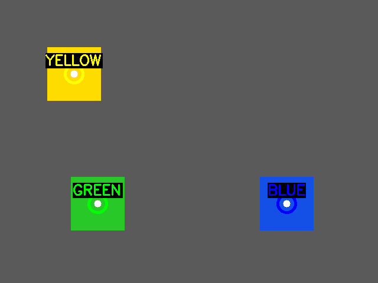

# Colored Object Picker

A ROS 2 Humble node that finds coloured objects in a camera image (HSV masks, morphology, centre-colour check) and publishes the largest per colour as a `PoseStamped`. Six colours configured in `config/colors.yaml`; 17 unit tests on the detection logic.



Real output of `ColorDetector` on a synthetic frame, made by `PYTHONPATH=. python3 scripts/make_demo.py` (no ROS, no camera).

## Quick start

Requires Ubuntu 22.04, ROS 2 Humble and a webcam (`sudo apt install ros-humble-cv-bridge python3-opencv python3-yaml`).

```bash
mkdir -p ~/colored_object_ws/src && cd ~/colored_object_ws/src
git clone <this repo URL>
cd .. && colcon build --packages-select colored_object_picker && source install/setup.bash
ros2 launch colored_object_picker detector.launch.py   # window labels coloured objects; poses on /detected_object_pose
```

Unit tests, no ROS or camera needed (from the repo root):

```bash
python3 -m pytest test/   # 17 tests: masks, centroids, validation, config loading
```

Node test without a camera: `cd src/colored_object_picker && launch_test test/test_launch_detector.py` (after `source install/setup.bash`) runs the installed node on an image topic: a black frame gives no pose, a yellow square at pixel (480, 120) gives (0.16, -0.12, 0.1) in `camera_link`. CI runs it in `ros:humble` on every push.

## Limits
`pixel_to_world()` returns the pixel offset from the image centre scaled by 1 mm/px with a fixed
z of 0.1 m. That is a planar target in the camera frame, **not** a metric 3D position: a metric
pose needs the camera intrinsics plus a depth source (RGB-D, stereo, or a known object size).

HSV ranges are tuned for one lighting setup; retune them in `config/colors.yaml` for yours.

More: topics and parameters, colour ranges, an end-to-end test without hardware, troubleshooting in [docs/DETAILS.md](docs/DETAILS.md).

## License

Apache-2.0, see LICENSE.
